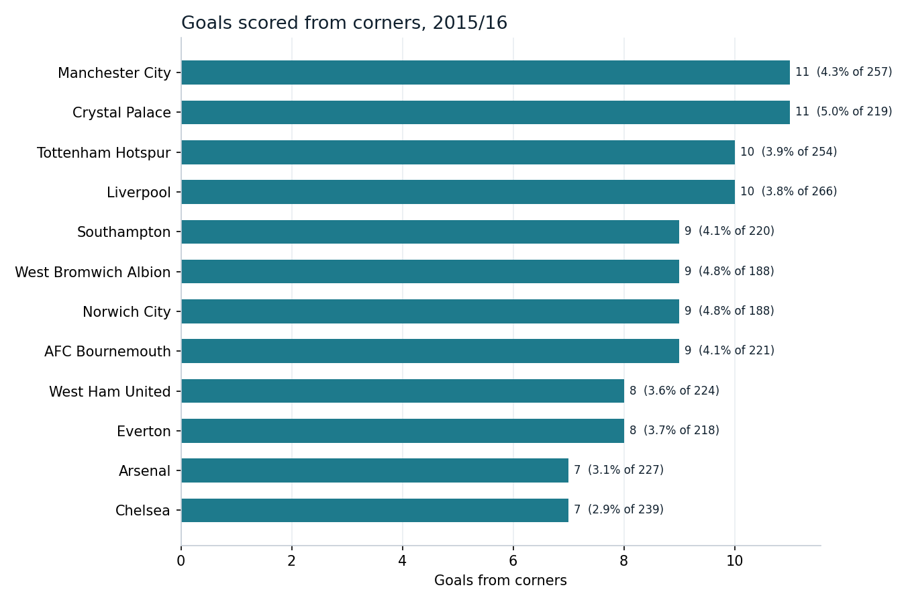
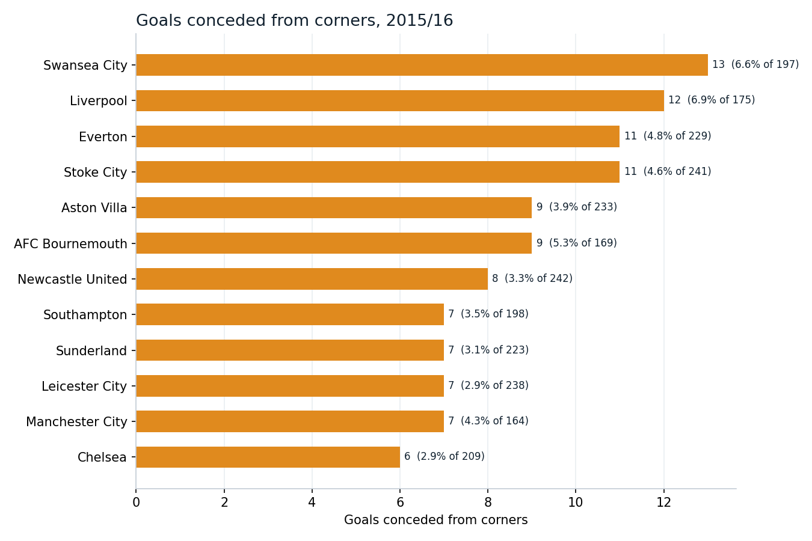
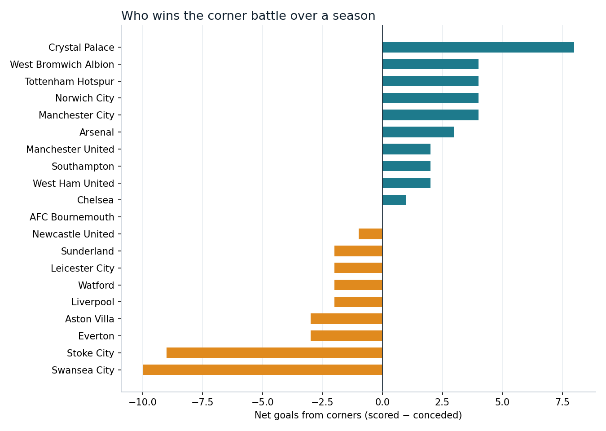
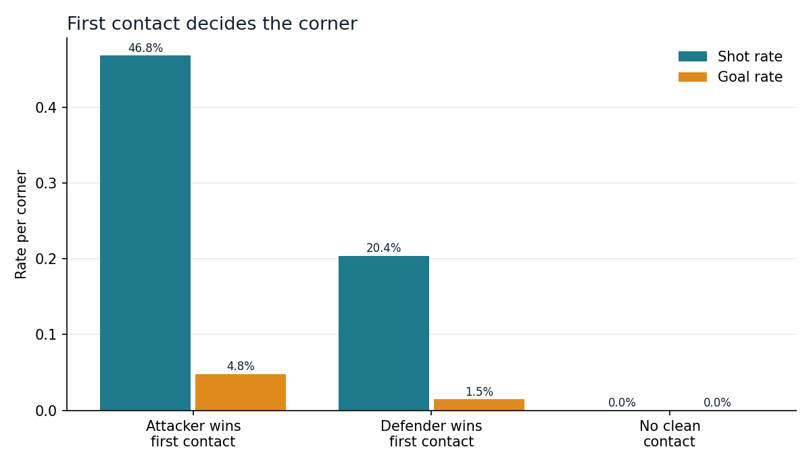
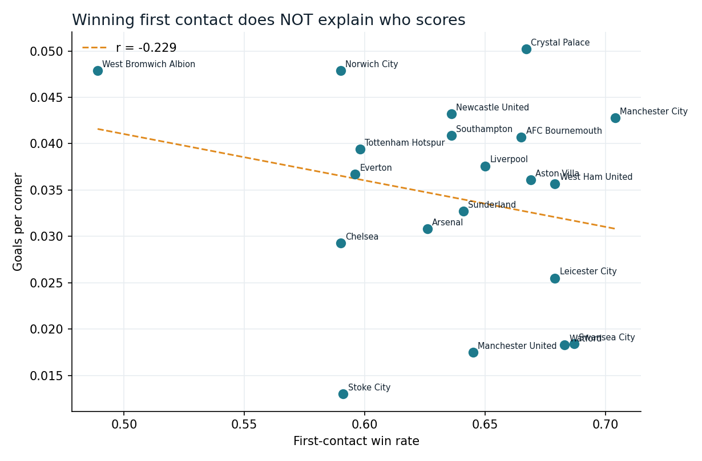

# Premier League corner analysis, 2015/16

Which teams scored most from corners, which conceded most, and what actually
explains it. Built from StatsBomb's open event data for the complete 2015/16
Premier League season: 380 matches, 4,107 corners, each linked to the passage
of play it started.



## Read this first: why 2015/16 and not 2025/26

You asked about the current season, and the honest answer shapes everything
below. Two kinds of set-piece data exist:

- **Aggregate totals** — how many set-piece goals a team scored or conceded.
  Partly published for 2025/26. The headline story is real and striking:
  it was a record-breaking set-piece season, Arsenal were its dominant force,
  and Burnley owned the worst defence in the league.
- **Per-corner event data** — who won first contact, the delivery type, where
  the ball landed, whether a shot followed. This is licensed StatsBomb/Opta
  data. For the current season it costs thousands of pounds and is not
  publicly available.

Every question you asked — first contact, cause of scoring and conceding —
needs the second kind. The one complete Premier League season StatsBomb release
free is 2015/16, so that is what this analysis uses. The method is identical
for any season; only the input file changes. Point it at licensed data and the
same code produces the same analysis for 2025/26.

Building it this way means every number here is checkable. Inventing 2025/26
per-corner figures would have produced a nicer headline and a portfolio piece
that collapses the moment an interviewer asks where the data came from.

## Who scored most from corners

Manchester City and Crystal Palace led with 11 goals each, then Tottenham and
Liverpool on 10. Palace are the interesting case: they scored as many as City
from fewer corners (219 vs 257), a 5.0% conversion rate against City's 4.3%.
For a team that finished 15th, corners were a disproportionate share of their
threat.

At the bottom, Stoke — long associated with set-piece power under Tony Pulis —
converted just 2 of 154 corners in the post-Pulis season, the league's lowest
rate. A reputation outliving the personnel.

## Who conceded most



Swansea conceded the most (13), then Liverpool (12). Liverpool are the standout
contradiction: strong attacking corners, but a leaky defence on their own goal
line, conceding 12 from 175 — a 6.9% rate, nearly the worst in the league.

The best defences allowed remarkably little. Manchester United conceded just 2
from corners all season, Palace 3, Arsenal 4. That Palace both scored the most
and conceded almost the fewest gave them the best net corner record in the
division.



## First contact: the mechanism



At the level of a single corner, who touches the ball first is close to
decisive:

| First contact | Corners | Shot rate | Goal rate |
|---|---|---|---|
| Attacker | 2,614 | 46.8% | 4.82% |
| Defender | 1,157 | 20.4% | 1.47% |
| No clean contact | 336 | 0.0% | 0.00% |

An attacking first touch is more than three times as likely to yield a goal as
a defensive one. And 336 corners produced no clean contact by anyone — the ball
cleared, or claimed by the keeper — and none of those led to a shot. Getting a
head or foot to the ball first is the whole game.

## Delivery and zone

Inswinging corners produced the most goals (3.75% goal rate), slightly ahead of
outswingers, but the more telling split is what they trade off. Outswingers won
the first contact more often and generated more shots; inswingers converted a
touch better when they came off — consistent with the inswinger's higher risk,
higher reward reputation, curling toward goal where a flick or a keeper error
can punish.

By landing zone, the near-post delivery had the highest goal rate (4.82%),
above central and far-post balls. The near-post flick-on remains the most
dangerous single target — though the confidence intervals overlap enough that
the ranking between zones is suggestive, not settled.

## The 'why' — and the finding that surprised me



Here is the result I did not expect. If first contact decides individual
corners, the teams that win first contact most often should score most from
corners. **Across the 20 teams, they don't.** The correlation between a team's
first-contact win rate and its goals-per-corner is -0.23 — weak, and the wrong
sign. On the defensive side it's -0.01, essentially nothing.

Both things are true at once, and reconciling them is the actual insight.
Winning first contact matters enormously *within* a corner. But a team's
season-long return from corners is driven more by how many corners it wins, the
quality of the delivery, and who is attacking the ball, than by the raw
first-contact percentage. Manchester City won first contact on 70% of their
corners and scored on 4.3%; West Brom won it on just 49% and scored on 4.8%.
Contact wins the ball; it doesn't guarantee the finish.

The naive version of this analysis stops at the first-contact table, declares
"win first contact to score more," and is wrong at the level that matters for a
coach deciding where to spend training time. The honest version reports the
tension.

## What would come next

- **Second-phase goals.** Outcomes are linked across the whole possession, so a
  corner cleared and worked back in still counts. Separating first-phase from
  second-phase attacks needs an event-count cutoff and would sharpen every rate
  here.
- **Player-level contact.** The data identifies who makes each contact, so the
  natural extension is which players win the most attacking and defensive
  first contacts — the set-piece specialists.
- **Point it at 2025/26.** With licensed event data, the same pipeline answers
  every question above for the current season, including the Arsenal
  phenomenon that made set-pieces the story of the year.

## Running it

```bash
pip install -r requirements.txt
python -m src.main          # command line: charts + tables to outputs/
jupyter lab                 # then open analysis.ipynb
pytest tests/
```

First run downloads and caches 380 match files; later runs are instant and work
offline.

## Structure

```
src/ingest.py     StatsBomb open-data client, possession linking, zones
src/analyse.py    Attacking + defending summaries, the why-correlation, Wilson intervals
src/main.py       Charts and the command-line pipeline
analysis.ipynb    The whole analysis, run, with charts inline
tests/            Count reconciliation, contact ordering, classifiers
```

## Sources and honesty notes

- Event data: StatsBomb Open Data, 2015/16 Premier League, used under their
  free user agreement.
- The 2025/26 context (record set-piece season, Arsenal's dominance, Burnley's
  defence) is from public reporting and aggregate stats providers; it frames
  the piece but is not part of the computed analysis, which is entirely 2015/16.
- Outcomes are linked by StatsBomb's possession counter, so figures include
  second-phase goals within the same possession. This is stated because it
  raises every conversion rate above a first-contact-only definition.
